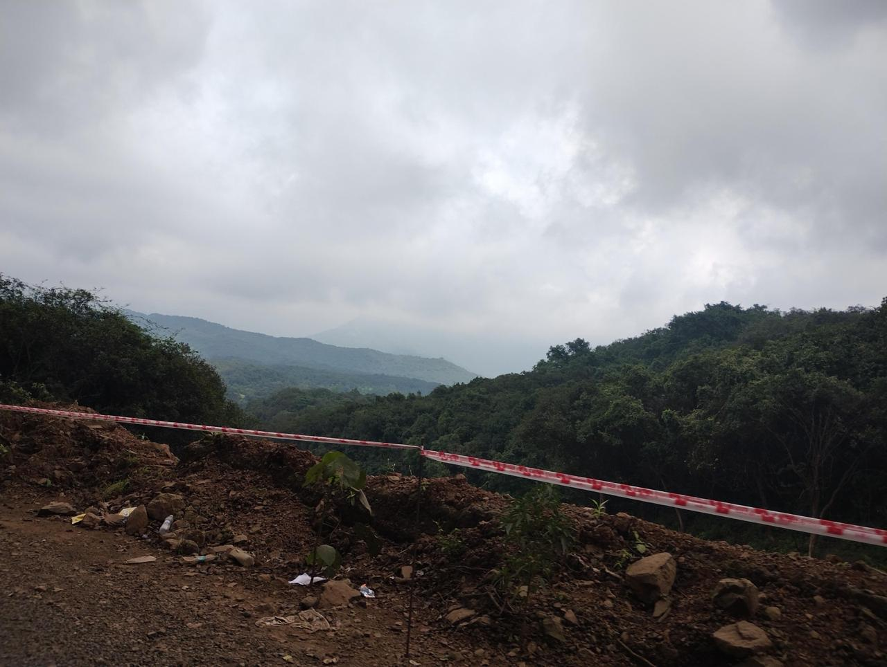

# Beyond the study area: Pavagadh Hill

The map's field survey covers Alkapuri, Sayaji Baug and the railway station area. Pavagadh Hill is about 45 km from Vadodara, so it is **not** part of the survey and has no pins on the map. This page keeps what Om photographed there as separate documentation.

## Photo 1: road cut with warning tape

- **Place:** Pavagadh Hill, on the road up the hill. Exact point not recorded yet.
- **Photographer:** Om Dorkar.
- **What it shows:** red and white tape across the edge of the road, loose soil, rocks and litter, and a steep drop beyond.
- **Barrier type:** none of the seven types on the map. It is a road hazard, not a footpath, ramp or entrance barrier. There is no footpath or kerb in the frame.

## Why it is kept separate

Everything on the map is a verified finding inside the study area. Adding hill-road photos there would mix a different kind of evidence into it. A proper accessibility survey of Pavagadh (steps, ramps, the ropeway, paths to the temples) would need its own walk.

## To add

- Date and exact location (latitude, longitude) of each photo.
- Whether the tape marks a landslide, road works or a closed section.
